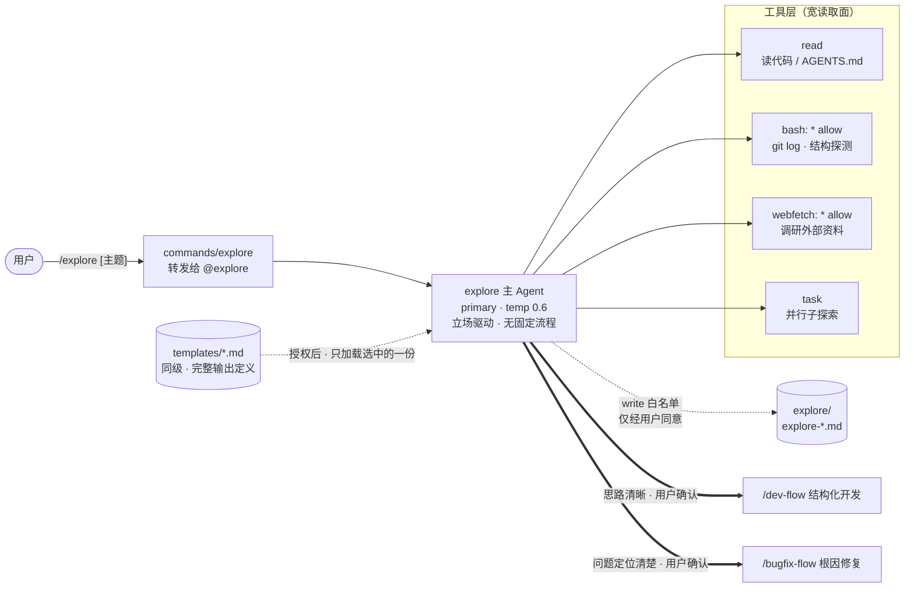
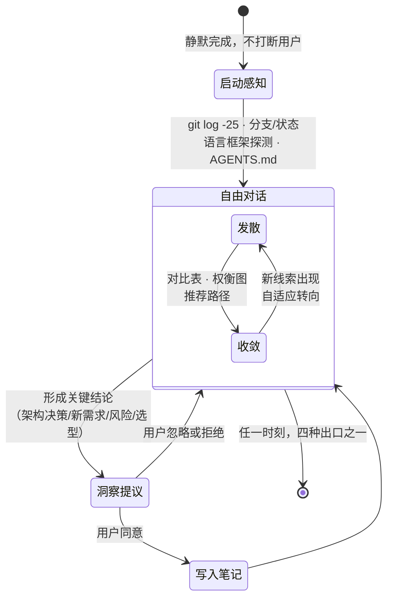
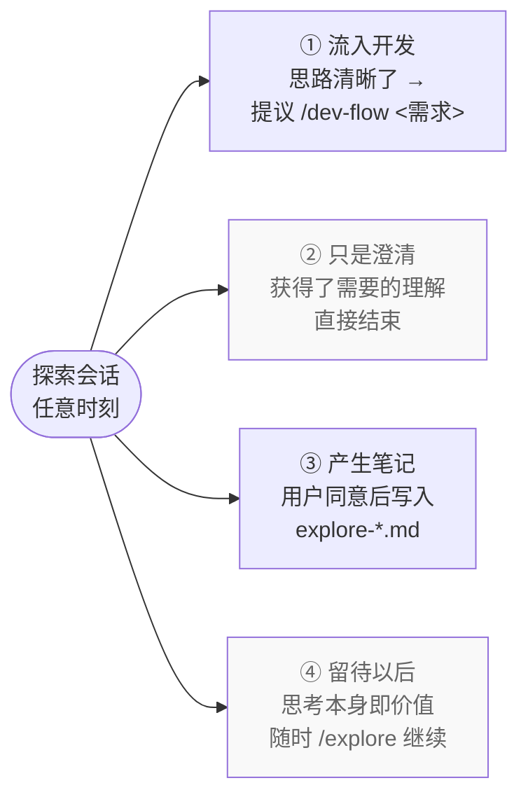
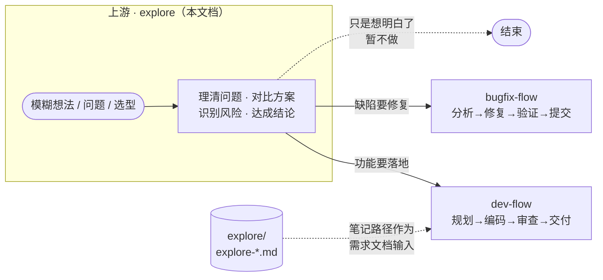

# explore Agent 设计文档

> Agent 定义：`.opencode/agents/explore/explore.md`（§3.2 只保留加载编排）
> 完整输出定义：`templates/{generic,backend,frontend}.md`（与各自 agent 定义同级）
> 同步脚本：`.opencode/agents/sync-explore.sh`（唯一源 → codebuddy 副本）
> 命令入口：`.opencode/commands/explore/explore.md`（`/explore [探索主题]`）

---

## 1. 概述与核心设计原则

### 1.1 概述

explore 是一个**自由探索模式**：深度思考、问题分析、选项对比。它是**思考伙伴，不是实现工具**。

用户一条命令即可进入：

```bash
/explore                                    # 空：agent 自行感知项目后主动开题
/explore 实时协作功能怎么设计                 # 模糊想法
/explore postgres vs sqlite 选哪个           # 技术选型
/explore 认证系统越来越难维护了               # 具体问题
/explore 登录流程怎么走的                     # 代码疑问
```

它最特殊的一点：**这是一种立场（stance），不是工作流（workflow）**——没有固定步骤、没有强制序列、没有必须产出。

### 1.2 在四个 flow 中的定位

四个 flow 按"结构化程度"排成一条光谱：

```text
结构化程度 ◀──────────────────────────────────────────────▶ 强结构

┌───────────────┬──────────────────┬──────────────────────┐
│ explore  │ bugfix-flow      │ review-flow          │
│               │                  │ dev-flow             │
├───────────────┼──────────────────┼──────────────────────┤
│ 立场驱动       │ 单 Agent 内联     │ 多 Agent 编排         │
│ 零步骤·零门禁  │ 4 步骤 · 3 类门禁 │ 状态机 · 批次 · 门禁   │
│ 无必须产物     │ 分钟级            │ 小时级                │
│ 温度 0.6 发散  │ 温度 0.2~0.3 收敛 │ 主控温度 0.0 机械调度  │
└───────────────┴──────────────────┴──────────────────────┘
        ▲ 探索"做什么、为什么"          解决"怎么做、做出来"
```

一句话分工：**explore 负责把问题想清楚，其余三个 flow 负责把事情做完**。

### 1.3 核心设计原则

| # | 原则 | 说明 |
|---|------|------|
| P1 | 思考而非实现 | 永不写应用代码；write 权限仅限探索笔记目录，源代码零写入 |
| P2 | 立场驱动 | 好奇而非说教、开放而非审讯、自适应转向，不照脚本念 |
| P3 | 接地探索 | 读真实代码库、git 历史，画真实架构图，不只纸上谈兵 |
| P4 | 可视化优先 | 大量使用 ASCII 图（架构草图、状态机、对比表、调用链）理清思路 |
| P5 | 提议式捕获 | 有价值的洞察只口头提议记录，**绝不自动写入** |
| P6 | 明确跃迁边界 | 即使用户说"就按这个做"，也必须先确认退出探索模式才能进开发流程 |

---

## 2. 架构设计

### 2.1 架构总览

单 primary Agent，无子代理编排。能力全部来自工具组合，写入面被权限白名单收敛到唯一点。**每份模板都是自包含的完整输出定义**，放在与 agent 定义同级的 `templates/` 目录；探索期不进上下文，仅在「确认存档」后延迟加载用户选中的那一份，成为提示词的一部分，不进入写入面。



### 2.2 目录结构

**静态定义**（仓库内：Agent 定义 + 命令入口 + 完整输出定义模板族）：

```text
.opencode/agents/
├── sync-explore.sh                # 单一源 → codebuddy 副本（正文 + templates）
└── explore/
    ├── explore.md                 # Agent 定义（frontmatter 配置 + 立场提示词 + §3.2 加载编排）
    └── templates/                 # 唯一手写源：完整输出定义，各自自包含
        ├── generic.md              # 兜底 + 弱结构：最小完整输出定义
        ├── backend.md              # 完整输出定义 + 后端填写指引（章节条件必填）
        └── frontend.md             # 完整输出定义 + 前端填写指引（章节条件必填）
.opencode/commands/explore/
└── explore.md                     # 命令入口：/explore [主题] → 转发 @explore
.codebuddy/agents/explore/         # 生成副本（sync-explore.sh 产出，不手写）
├── explore.md                     # 同一正文，仅 yaml 头不同
└── templates/                     # 三份模板副本，frontmatter 内含生成标记
```

**运行产物**（项目根下按需生成，全 Agent 唯一可写区）：

```text
./explore/
└── explore-auth-refactor-2026-09-16.md
#   └── explore-{topic-slug}-{YYYY-MM-DD}.md
```

| 要素 | 规则 |
|------|------|
| 写入时机 | 仅当讨论中自然形成有价值结论 **且用户明确回复「确认存档」** 后才创建 |
| 文件格式 | **由所选模板自包含定义**：frontmatter 字段集、H2 章节集合与规则、产物骨架、落笔前自检，全部随模板走；`explore.md` 不含任何字段表或章节表。**对话自由，产物不自由** |
| 产物地址 | 目录 `explore/`、命名 `explore-{topic-slug}-{YYYY-MM-DD}.md` **只在 `explore.md` §3.2 定义一次**，与 `permission.edit` 白名单绑定；模板不重复描述，也不得改变写入地址 |
| 模板来源 | 落笔后扫描 `templates/*.md`（**相对本 agent 定义所在目录**，不写项目相对路径），只读 frontmatter 元信息；用户一次确认选定后**只加载选中模板全文**，该文件即提示词的一部分；`template: {name}@{version}` 写入产物以便复现；模板不得放进产物目录 |
| 分发 | 两侧 `development.sh` 均为整目录 `cp -r`，agent 定义与同级 `templates/` 一起部署到用户目录；`sync-explore.sh` 负责把唯一源同步成 codebuddy 副本并校验一致性，两个 `development.sh` 无需改动 |
| 兜底 | `generic.md` 随 agent 分发、不可删光；目录为空 / 文件损坏 / 无合法候选时作为最小完整输出定义，避免「已授权但无输出定义」的死局 |
| 下游用途 | 文件路径可作为 `/dev-flow <需求文档路径>` 的输入；笔记只保证**结构可读**与**模板版本可复现**，怎么取、取哪些由下游自行决定 |

> Agent 定义 §3.2 只保留：行为边界、落笔触发、最小加载编排（扫描 / 候选 / 一次确认 / 延迟加载 / 兜底）与「按模板自检」一句。**新增或替换模板只需在源目录 `templates/` 放一份自包含 md，运行 `sync-explore.sh` 即可，不必改 agent 定义**；模板可自由增删章节与字段，不描述产物地址，也不规定下游取用方式。

### 2.3 配置属性

来自 Agent frontmatter：

| 配置项 | 取值 | 说明 |
|--------|------|------|
| `mode` | `primary` | 主对话 Agent，直接与用户多轮交互 |
| `temperature` | `0.6` | 四个 flow 中最高，利于发散思维与头脑风暴（对比 dev-flow 主控 0.0、bugfix-flow 0.3、review-flow 0.2） |
| `model` | `opencode-go/deepseek-v4-flash` | 轻量快速模型，匹配探索对话高频低风险的特点 |
| `tools` | read / bash / webfetch / task / write 开，`edit` 关 | 探测类工具齐备支撑"查码 + 调研 + 并行研究"；`edit` 显式关闭，杜绝源码改写 |
| `permission.bash` | `"*": "allow"` | git 历史、目录扫描等探测命令免确认 |
| `permission.webfetch` | `allow` | 外部技术调研免确认（`webfetch` 仅支持简写值，不支持 glob 对象） |
| `permission.edit` | `"*": "deny"` + `"explore/*": "ask"` + `"**/explore/*": "ask"` | **关键安全设计**：`edit` 这一把钥匙同时管控 write / edit / apply_patch；全局 deny，仅探索笔记路径 ask |

权限设计的核心是**宽读取、窄写入的漏斗形**：

```text
读取面（宽，免确认）                写入面（窄，双保险）
┌─────────────────────┐           ┌──────────────────────┐
│ read  bash *        │  全库可见  │ edit ──▶ 提议 → 用户  │
│ webfetch *  task    │  ───────▶ │ 同意 ──▶ 仅允许写入    │
└─────────────────────┘           │ explore/*             │
                                  └──────────────────────┘
                                        源代码零写入
```

> **注意**：`write` 不是合法的 permission key，`permission.write` 不会生效——写入必须由 `permission.edit` 收敛。
> `tools` 仅有 `true/false` 两态，无法表达路径级白名单，因此不能替代 `permission.edit` 承担写入收敛职责。
> 模板放在与 agent 定义同级的 `templates/`（仓库内只读资源），正因为 codebuddy 侧 agent 无 `permission` 段、工具全局可写，模板若进产物目录会被误写。

---

## 3. 工作流详解

### 3.1 为什么说它"不是工作流"

dev-flow / bugfix-flow / review-flow 都有状态机、门禁和必产文件；explore 刻意全部放弃：

| 维度 | 其余三个 flow | explore |
|------|--------------|--------------|
| 流程形态 | 固定步骤序列 | 自由对话，跟随话题漂移 |
| 状态机 / 状态文件 | `.flow-state.json` 断点续作 | 无，会话即状态 |
| 人工门禁 | 方案确认等强制关卡 | 无门禁，只有出口提议 |
| 必须产物 | plan.md / fix-result.md 等 | 无必须产出，笔记可选 |
| 结束条件 | 交付 / 回滚等明确终点 | 没有固定终点，随时可走可留 |

### 3.2 交互模型

虽然没有流程，但每次调用有一个轻量的**感知—对话循环**：



两个要点：

- **启动感知是静默的**：agent 先自行摸清项目背景再接话，用户看不到原始输出；
- **发散⇄收敛交替**：同时抛出多个有趣方向让用户选（发散），选定后用图表深挖（收敛），新信息出现即转回发散。

对话中的典型动作：澄清提问、挑战假设、重新框定问题、绘制 ASCII 架构图、构建选项对比表、暴露风险与未知、用 Task 工具并行研究多条线索。

> 模板不介入上述循环：**探索期上下文里没有模板**，用户无需考虑笔记格式；模板只在「确认存档」之后延迟加载选中的一份，作用于产物，不回溯约束对话过程（Agent 定义 §3.1 的授权规则保持不变）。

### 3.3 结束方式：没有终点，只有四种出口



注意出口①的守护规则：即使探索中已经达成一致，agent 也**不会直接开工**，而是问："要退出探索模式，通过 `/dev-flow <需求描述>` 进入结构化开发吗？" —— 明确确认后才发生模式跃迁（P6）。

### 3.4 作为 dev-flow / bugfix-flow 的前置步骤

explore 位于所有执行流程的上游，负责"想清楚"，再把接力棒交给"做出来"的 flow：



**上下文如何交接给下游**（松耦合，两种方式）：

| 交接方式 | 用法 | 说明 |
|----------|------|------|
| 显式交接 | `/dev-flow explore/explore-auth-refactor-2026-09-16.md` | 探索笔记直接作为需求文档输入，与 brainstorm.md 同位；章节结构按所选模板可读 |
| 口头交接 | `/dev-flow 实现基于 Postgres 的会话存储` | 探索中达成的结论由用户复述为需求描述 |

**与 bugfix-flow 的关系**：修复前先用 `/explore 登录报 500 是怎么回事` 把根因和影响面讨论清楚，再带着结论进入 `/bugfix-flow`，可显著减少方案返工。

> 松耦合说明：下游 flow **并不依赖**探索笔记存在——没做过探索也能直接启动 dev-flow / bugfix-flow；笔记只是提升输入质量的可选加速器。本轮未改 `dev-plan` 侧的显式解析；**上游只保证结构可读与 `template: {name}@{version}` 可复现，不规定下游如何取用**，取用方式由下游自己决定，避免下游改动使上游的映射表失效。

---

## 4. 演进记录

> 约束是长出来的，不是预判出来的。本节记录**实际观察到的漂移**及据此补充的约束；
> 每条须有真实案例背书，无案例不预先加约束。

| 日期 | 观察到的漂移 | 补的约束（落点） | 理由 |
|------|--------------|------------------|------|
| 2026-11-13 | 6/6 份真实笔记只有 `date` + `topic`，0/6 有 `source`、0/6 有状态标注，章节名各写各的；agent 定义写了字段但产物不生效 | 落笔前校验动作 + 模板独立成文件（`templates/`） | explore 与 dev-plan 之间缺字段级契约，靠 LLM 意会转译，评审与交接都不稳定；「定义写清 ≠ 字段会出现在产物」，故须自带落笔前校验 |
| 2026-11-13 | 初版把契约写在 `explore.md`、骨架写在模板，形成两处真相源：模板不是完整输出定义、改模板要改 agent；§3.2 膨胀到 137 行，同时承担行为准则 + schema 注册表 + 流程实现；`assert L1 章节 all in template` 使骨架无法特性化 | 取消 L1/L2 两层拆分，**输出定义全量下沉**：每份模板自包含字段集 / 章节规则 / 落笔前自检（`explore-template/v2`）；`explore.md` §3.2 压到约 25 行，只留行为边界、最小加载编排与兜底；删除 `assert` 与硬编码 `check_L1`，改为授权后延迟加载选中模板全文 | 模板加载进提示词后本身就是完整输出定义，无需在 agent 里复述；且 `dev-plan` 当前仅「合并到用户需求」，L1 的下游收益尚未兑现而成本立即发生。保留的只是先于模板存在的行为红线与加载自举规则，不属于 L1 契约 |
| 2026-11-13 | 审查发现：agent 定义写项目相对路径 `.opencode/agents/explore/templates`，部署到用户目录后失效；模板重复「产物路径与命名」与 agent 定义打架；模板内「下游映射（供 dev-plan 取用）」形成反向依赖且随下游改动失效；5 个定义节与 8 个产物 H2 同级，排版混乱 | 模板路径改为相对 agent 定义的 `templates/*.md`；`sync-explore.sh` 把唯一源同步成 codebuddy 副本（两侧 `development.sh` 整目录分发，无需改动）；删除模板的「产物路径与命名」与「下游映射」两节；模板重排为「输出格式定义 + 约束与要求」两大块，产物骨架用 fenced code block 包裹 | 相对路径保证部署可移植；产物地址属于 agent 写入动作并与 `permission.edit` 白名单绑定，只能有一处；上游产物定义不规定下游取用方式；fenced 骨架隔离 H2 层级冲突 |
